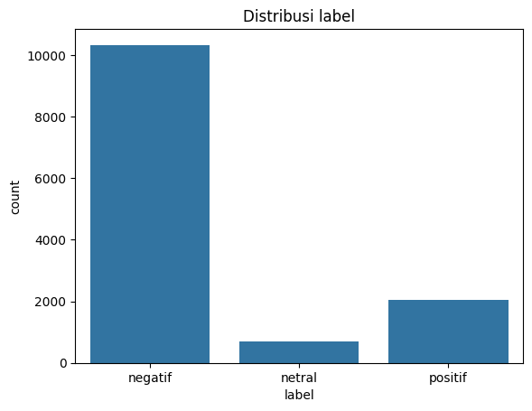
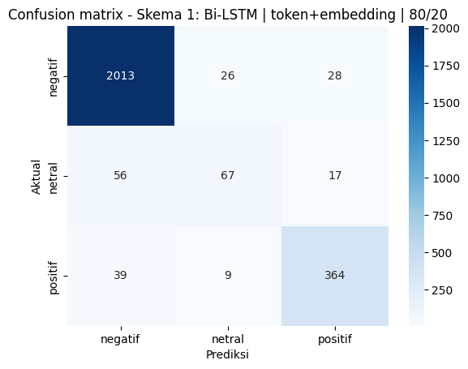

# Analisis Sentimen Ulasan Gojek (Google Play Store)

Klasifikasi sentimen ulasan aplikasi Gojek ke tiga kelas (negatif, netral, positif). Alurnya dari scraping sampai inferensi, dengan tiga skema pelatihan yang dibandingkan.

Proyek ini dikerjakan sebagai submission kelas *Belajar Fundamental Deep Learning* (Dicoding). Bantuan AI (Claude) dipakai untuk menyusun kode dan debugging.

## Alur

1. **Scraping** (`scraping.py`): `google-play-scraper`, bahasa dan negara Indonesia, tiap rating 1-5 diambil sampai 4.000 ulasan. Hasil: 17.352 ulasan unik.
2. **Pembersihan teks**: lowercase, hapus URL dan simbol, rapikan huruf berulang ("bagusss" jadi "bagus"), normalisasi kata gaul. Stopword sengaja tidak dibuang.
3. **Pelabelan**: model sentimen `w11wo/indonesian-roberta-base-sentiment-classifier` membaca teks asli ulasan. Prediksi dengan keyakinan rendah (ambang 0,90 untuk negatif dan positif, 0,70 untuk netral) dibuang, begitu juga ulasan yang ratingnya bertentangan jelas dengan label (rating 5 berlabel negatif, rating 1-2 berlabel positif). Sisa data: **13.093** ulasan.
4. **Pelatihan**: tiga skema dengan kombinasi berbeda, lalu evaluasi dengan classification report dan confusion matrix.
5. **Inferensi**: fungsi `prediksi_sentimen()` memakai skema dengan akurasi uji tertinggi.

Distribusi label akhir: negatif 10.332, positif 2.059, netral 702.



## Hasil

| Skema | Model | Fitur | Split | Train | Test | F1 macro |
|---|---|---|---|---|---|---|
| 1 | Bi-LSTM | token + embedding | 80/20 | 0,9892 | 0,9332 | 0,8016 |
| 2 | MLP | TF-IDF (1-2 gram) | 80/20 | 0,9657 | 0,9267 | 0,7594 |
| 3 | CNN 1D | token + embedding | 70/30 | 0,9892 | 0,9285 | 0,7980 |

Recall kelas netral di data uji: 0,48 (skema 1), 0,34 (skema 2), 0,50 (skema 3).



Contoh inferensi (skema 1):

```
POSITIF  (1.00)  <-  Aplikasinya bagus banget, pengemudi ramah dan pesanan cepat sampai
NEGATIF  (1.00)  <-  Parah, pesanan dibatalkan sepihak dan saldo tidak kembali, sangat mengecewakan
NETRAL   (0.97)  <-  Aplikasi untuk memesan ojek, makanan, dan kirim barang
NEGATIF  (1.00)  <-  Tidak bagus, sering error dan lambat
```

## Keterbatasan

- **Label berasal dari model lain**, bukan anotasi manusia. Akurasi di sini mengukur seberapa jauh model kecil ini meniru IndoRoBERTa, bukan seberapa benar terhadap sentimen sesungguhnya.
- **Kelas tidak seimbang.** Menebak "negatif" untuk semua ulasan sudah dapat sekitar 79%, jadi akurasi 0,93 tidak sebesar kedengarannya. Kelas netral paling lemah (recall di bawah 0,5).
- **Data uji lebih mudah dari data asli**, karena ulasan yang meragukan sudah dibuang saat pelabelan.
- **Selisih antar skema kecil** (0,927 sampai 0,933) dan hanya satu kali run per skema, jadi tidak cukup untuk menyimpulkan satu arsitektur lebih baik dari yang lain.
- Satu aplikasi dan satu waktu scraping. Belum diuji pada aplikasi atau domain lain.

## Menjalankan

```bash
pip install -r requirements.txt
python scraping.py              # opsional, hasilnya akan beda dari dataset yang disertakan
jupyter notebook analisis_sentimen.ipynb
```

Pelabelan dan pelatihan jauh lebih cepat dengan GPU (dijalankan di Google Colab, T4).

## Isi repo

- `scraping.py`: pengambil ulasan
- `analisis_sentimen.ipynb`: pembersihan, pelabelan, tiga skema, inferensi (output sudah tersimpan)
- `dataset_ulasan_gojek.csv`: ulasan mentah hasil scraping
- `dataset_berlabel.csv`: data setelah pembersihan, pelabelan, dan penyaringan
- `assets/`: gambar hasil dari notebook
